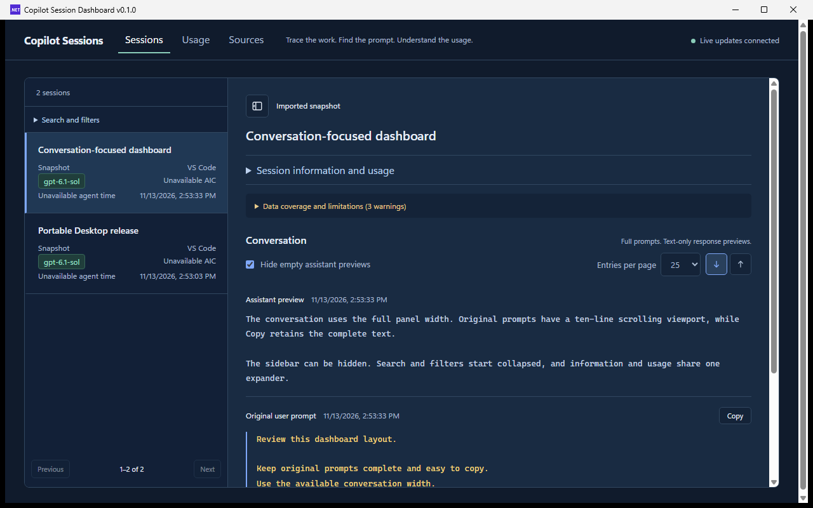

# Copilot Session Dashboard

A portable Windows Desktop app for exploring Copilot CLI and VS Code sessions.
Read conversations, find and copy complete original prompts, and inspect recorded
usage in one local-only window.

## Desktop example



Synthetic example captured from the actual Release app using
`CopilotSessionDashboard (Defender ASR).cmd`, with isolated temporary data.
No real conversation history is shown.

## Download and run

Published ZIP packages appear in [GitHub Releases](https://github.com/iljoong/win-copilotsession/releases).
Download `CopilotSessionDashboard-<version>-win-x64.zip`. The current source
version is recorded in [VERSION.md](VERSION.md); a source checkout is not itself
a published release.

The app targets Windows 11 x64 and Windows 10 22H2 x64. Windows 11 has been
tested; Windows 10 verification remains pending. It requires the
[Microsoft Edge WebView2 Runtime](https://developer.microsoft.com/microsoft-edge/webview2/).
Node.js and .NET runtimes are bundled: end users do **not** need npm, Node.js,
or the .NET SDK. The app does not install WebView2 automatically.

1. If Windows marks the downloaded ZIP as blocked, review its origin and
   organization policy, then use the ZIP's **Properties > Unblock** before
   extracting it.
2. Extract the complete ZIP into a folder you own.
3. Open the extracted `CopilotSessionDashboard` folder and run the appropriate
   entry point:

| Entry point                                  | Use                                                                             |
| -------------------------------------------- | ------------------------------------------------------------------------------- |
| `CopilotSessionDashboard.exe`                | Ordinary PCs where the unsigned apphost is permitted                            |
| `CopilotSessionDashboard (Defender ASR).cmd` | Managed PCs using the bundled Microsoft-signed `runtime\dotnet.exe` entry point |

The two entry points run the same app. The unsigned EXE may produce a SmartScreen
warning; follow your organization's policy and read the included
`README-FIRST.txt`. Do not disable Defender or add exclusions.

There is no installer, administrator prompt, auto-start, or tray process. Closing
the window stops the app and its backend. Starting it again while it is running
brings the existing window forward. A console may flash briefly with the `.cmd`.

Do not run Desktop and the developer/browser mode simultaneously: they share the
same dashboard data and simultaneous use is unsupported.

## First use

Open **Sources** and choose what to read. Nothing is enabled automatically.

- **Copilot CLI history:** review the displayed path and explicitly authorize
  read-only collection. Original session files are never modified.
- **VS Code chats:** export a conversation with **Chat: Export Chat...** and
  import the JSON. Imported chats are historical snapshots.
- **Telemetry:** optional, separately configured by you; see the detailed manual
  before enabling content capture.

In **Sessions**, the sidebar icon hides/shows the list. Search and filters start
collapsed. The selected session has **Conversation** (default), **Session Info**
and **Todo status** tabs. Long original prompts scroll after ten displayed lines, but
**Copy** preserves the complete original text. Assistant previews are inert text.

**Todo status** groups CLI TODOs by dependency links, including standalone tasks.
Group cards show completion, source statuses and creation-to-last-update spans,
latest modified first (creation ordering is also available). Expand a group for
only its dependency graph, with each task's title, ID, source creation time and
status. **All tasks** retains the newest-created-first table. Spans are not execution durations.
Progress is `done / all TODOs`, including off-page rows. Only the active view
refreshes. An enabled CLI-history source and readable `session.db` are required;
missing dependency/timing data is labeled, and empty/unavailable TODO data has
no completion percentage.

**Usage** shows recorded values and coverage, not estimated billing. Missing
metrics are not zero, and an idle turn is not a completed session.

## Your data stays local

The app uses authenticated loopback connections and no cloud account, CDN,
or application telemetry. Dashboard data normally lives in:

```text
%LOCALAPPDATA%\CopilotSessionDashboard\dashboard-data
```

This includes full prompts, so protect it like your Copilot history. Native logs
and the WebView2 profile are in the sibling `desktop` folder. Nothing is written
inside the extracted app folder. Local authentication does not isolate data from
other processes running as your Windows user.

TODO reads use disposable DB/WAL copies in your user temporary directory to
leave original SQLite sidecars untouched. Only the five TODO fields and dependency
links are queried for display;
copies are removed after each read, but a crash can leave temporary files.

**Clear local data** requires confirmation, clears dashboard records and disables
sources, but never deletes original history/exports. It is not secure disk erasure.
Deleting the extracted app removes the program, not your dashboard data.

Read the [detailed manual](manual/README.md) for source boundaries, permissions,
usage accounting, telemetry privacy, and compatibility limitations.

## For contributors

| Guide                                       | Contents                                                      |
| ------------------------------------------- | ------------------------------------------------------------- |
| [Development](manual/development.md)        | Source setup, browser mode, architecture, packaging           |
| [Testing](manual/testing.md)                | Browser/native gates, synthetic fixtures, Defender checks     |
| [Versions and releases](manual/releases.md) | VERSION.md, explicit version requests, GitHub ZIP publication |
| [AGENTS.md](AGENTS.md)                      | Contributor/agent workflow and privacy boundaries             |

Versions are changed only on an explicit next-version or specific-version request.
Ordinary commits/pushes never increment them. GitHub Actions publishes on a
`main` push changing VERSION.md, or on a manual run; published versions are not
silently overwritten.
